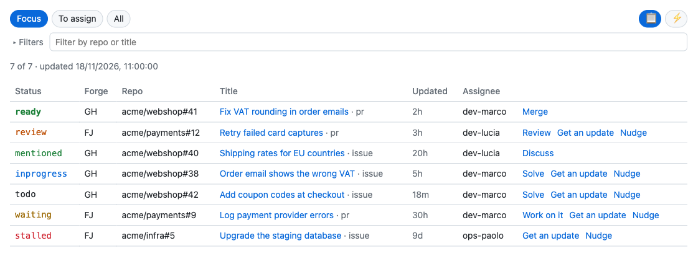
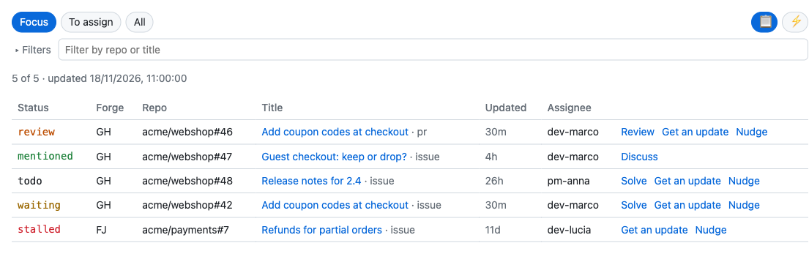
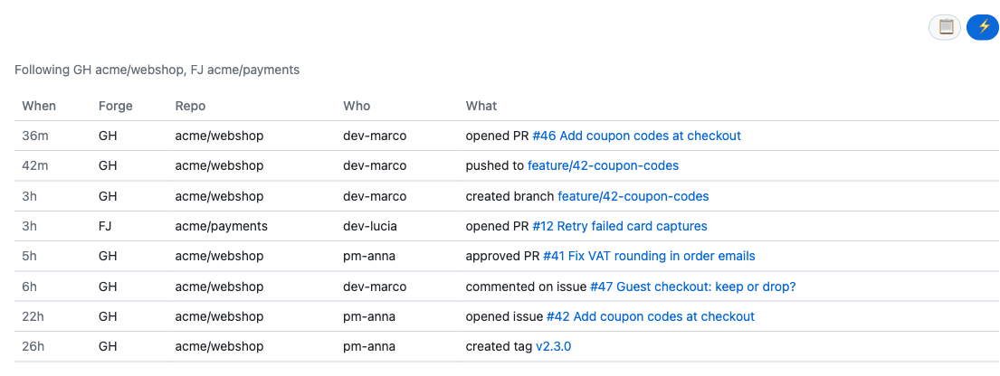

# forge-desk guide

forge-desk is one grid of **your** open issues and pull requests, across GitHub and Forgejo,
inside the Claude Desktop Code tab. Each row carries a status that answers one question —
*whose move is it?* — and a few links that open a Claude session to make that move.

You stop checking two forges, a mailbox of notifications and a list of PRs: you open the desk,
read it top-down (most urgent first) and click.

The screenshots below are the browser version of the desk (🌐 in the pane) with demo data:
repositories `acme/*`, a project manager `pm-anna`, a developer `dev-marco`.

## The statuses

| Status | Whose move | What to do |
|---|---|---|
| `ready` | yours | your PR is approved (or needs no review), green, no conflicts: **Merge** |
| `review` | yours | someone asked you to review their PR: **Review** |
| `mentioned` | yours | someone wrote `@you` and you have not answered: **Discuss** |
| `inprogress` | yours | work you have started: an issue with commits or a PR, a draft, a PR with changes requested or red CI |
| `todo` | yours | an issue assigned to you, not started yet: **Solve** |
| `waiting` | someone else's | assigned to someone else, or your PR waiting for a reviewer |
| `stalled` | someone else's | waiting, but nothing moved for 7 days: **Nudge** |
| `tobeassigned` | nobody's | an issue you opened that nobody has taken |

Every action opens a new Claude session in your local checkout of that repository, so the
project's own rules apply. Nothing is posted, merged or commented without your OK — except
**Merge**, where the click is the OK.

## A worked flow: from assignment to merge

**1. The PM assigns an issue.** Anna opens `acme/webshop#42` *Add coupon codes at checkout* and
assigns it to Marco.

**2. The developer finds it on the desk as `todo`.** No notification to dig out: it is a row on
Marco's desk, with **Solve** beside it. The same desk also tells him that one of his PRs is
`ready` to merge, that Lucia is waiting for his review, and that an issue he follows has been
`stalled` for nine days.



**3. Work starts: `inprogress`.** Marco clicks **Solve**: a Claude session opens in his
checkout, reads the issue and works on a branch. As soon as the branch has a commit that
references the issue, or a PR linked to it, the row turns `inprogress`.

**4. The PR asks for review: `review` on the PM's desk.** Marco opens PR `#46` and requests a
review from Anna. On Marco's desk the PR shows `waiting` (the move is Anna's); on Anna's desk it
shows `review`, at the top. Anna clicks **Review**: Claude reviews the PR and reports the
findings to her; nothing is posted on the PR until she says so. The issue `#42`, which
Anna follows, shows `waiting` on Marco.



**5. Approved and green: `ready` for the author.** Once Anna approves and CI is green with no
conflicts, the PR turns `ready` on Marco's desk. He clicks **Merge**: Claude checks once more
that it is still approved, green and conflict-free, then merges.

**6. Done.** The PR is merged and the issue closed: both leave the desks. Nobody has to tidy
anything up.

Along the way:

- **`mentioned`** — Marco asks Anna `@pm-anna, guest checkout: keep or drop?` in an issue. It
  shows on her desk until she replies; **Discuss** explains what is being asked and drafts the
  answer.
- **`waiting` / `stalled`** — work in someone else's hands. After 7 quiet days it turns
  `stalled`, and **Nudge** drafts a polite reminder for the assignee.

## Activities

The ⚡ button at the top right switches to **Activities**: a feed of what happens on the
repositories you follow — pushes, branches, tags, issues and PRs opened, reviewed, merged —
newest first. In the pane, follow a repository by writing `owner/repo` or pasting its URL. An event about an
issue or PR offers **Follow**: the item joins your desk even if it is not assigned to you, which
is how a PM keeps an eye on an issue handed to a developer.



## Time log

forge-desk records how long development sessions are active, so the time can be summed per issue
by tools that read it (p2kit's timesheets). There is no timer: a session's active time is its
turns, from the prompt to the end of the answer, plus the gap before the next prompt when it is
15 minutes or less; a longer gap is idle and left out. Subagents' turns add nothing.

Each turn appends one line to `~/.claude/timelog/<yyyy-mm-dd>.jsonl`, split at midnight:

```json
{"start":"2026-11-26T10:02:00+01:00","end":"2026-11-26T10:08:00+01:00","remote":"hub.genro.com/acme/app","ref":"#7","kind":"dev","source":"forge-desk"}
```

`remote` is the checkout's origin, so worktrees of one repository count together. `ref` is the
issue or PR a session was opened on from the desk (Solve, Review, Work on it, …), when it runs in
that item's repository; any other session has `null`. Sessions outside a repository with a remote
are not logged. The lines are contiguous intervals: sum them, never merge them by hand.

## With p2kit

forge-desk is the desk of **one person**: what is on my plate. [p2kit](https://github.com/dgpaci/p2kit)
is the desk of **the project**: the PM groups issues and PRs into work packages, plans stages and
reports to the board. The two meet on the issue — the row Marco sees as `todo` is, on the project
desk, part of a work package; when the branch is run with the phased workflow plugin (`wf`), the
work package also shows the workflow's phases as they are completed.
